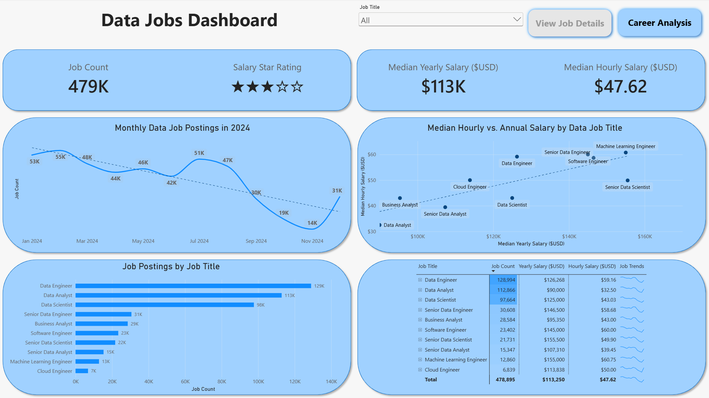

# Data Jobs Dashboard w/ Power BI

## Introduction

This interactive Power BI dashboard was initially developed as part of [Luke Barousse's Power BI for Data Analytics course](https://www.lukebarousse.com/powerbi). It analyzes 2024 data science job postings to help job seekers and career changers explore hiring trends, salary distributions, and employment opportunities.

The report consolidates job market information into two interactive pages, allowing users to compare roles, identify trends, and explore detailed information about specific job titles.

The dataset used in this project was provided through Luke Barousse's course and is available in the [course's GitHub repository](https://github.com/lukebarousse/PowerBI_Data_Analytics_Course/tree/main/Data).

### Dashboard File
You can find the file for the dashboard here: [`Data_Jobs_Dashboard.pbix`](/Data_Jobs_Dashboard.pbix).  

## Skills Showcased

This project demonstrates proficiency in the following Power BI tools and techniques:

-   **Data Transformation (ETL) with Power Query:** Cleaned, shaped, and prepared the raw data for analysis by handling blanks, changing data types, creating new columns and Standardizing inconsistent job platform names to improve data consistency and ensure accurate aggregation in visualizations.
-   **Data Aggregation:** Used Power BI's built-in aggregation functions to calculate job metrics such as `Median Yearly Salary` and `Job Count`.
-   **Core Charts:** Utilized **Column, Bar, Line, Scatter, Donut** and **Gauge Charts** to compare job counts and track trends over time.
-   **Geospatial Analysis:** Leveraged **Map Charts** to visualize the global distribution of jobs.
-   **KPI Indicators & Tables:** Used **Cards** to display key metrics and **Tables** to provide granular, sortable data.
-   **Dashboard Design:** Designed an intuitive and visually appealing layout, exploring both common and uncommon chart types to best tell the data story.
-   **Interactive Reporting:**
    -   **Slicers:** To dynamically filter the report by Job Title.
    -   **Buttons & Bookmarks:** To create a seamless navigation experience.
    -   **Drill-Through:** To navigate from a high-level summary to a contextual, detailed view.
---

## Dashboard Overview

*This report is split into two distinct pages to provide both a high-level summary and a detailed analysis.*

### Page 1: High-Level Market View

  

This is your mission control for the data job market. It showcases key KPIs like total job count, median salaries, and top job titles to give you a quick understanding of what's happening in the job market at a glance. All visuals are interactive to allow users to quickly filter by job title or date/quarter and then drill through to view specific details about the selected job title.

  

**Interactive Filtering Example:** Selecting Data Analyst and Q2 2024 updates the dashboard to display approximately 30K matching job postings, along with their corresponding salary metrics and trends.

#### Notes:
The Salary Star Rating evaluates job titles based on their median annual salaries. Roles with a median salary of $150,000 or higher receive five stars, while those below $75,000 receive zero stars. Ratings between these thresholds are assigned according to predefined salary ranges.

### Page 2: Job Title Drill Through

  

This is the deep-dive page. From the main dashboard, you can drill through to this view to get specific details for a single job title, including salary ranges, work-from-home stats, top hiring platforms, and a global map of job locations. Users can click the back arrow to go back to the main dashboard and select a different job title.

## Key Findings

-   **Overall Job Market:** The dataset contains approximately 479,000 data-related job postings from 2024, with an overall median reported annual salary of approximately $113,000.
-   **Most In-Demand Roles:** Data Engineer accounted for the largest share of postings (26.9%), followed by Data Analyst (23.6%) and Data Scientist (20.4%).
-   **Remote Work Availability:** Approximately 10% of Data Analyst postings were explicitly identified as offering work-from-home opportunities.

---

## Dataset Limitations:
-   **Degree Requirements:** A job posting that does not explicitly mention a degree may still require one.
-   **Health Insurance:** A posting that does not mention health insurance does not necessarily indicate that the employer offers no coverage.
-   **Remote Work:** Job postings not explicitly identified as remote should not automatically be classified as on-site positions.

---

## Conclusion

This project demonstrates how Power BI can be used to transform job posting data into an interactive analytical report. By combining market-level trends with detailed job-title analysis, the dashboard helps users compare career opportunities while showcasing practical skills in data preparation, visualization, and interactive reporting.

