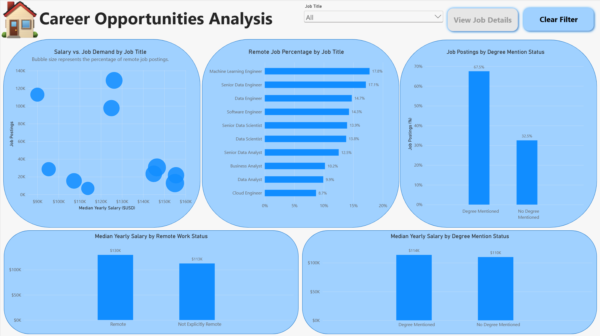
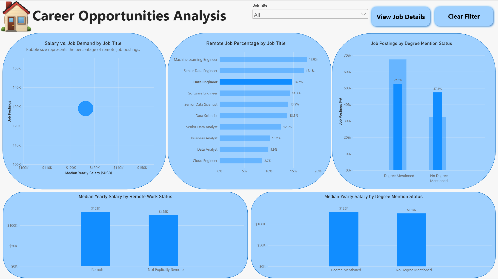

# Data Jobs Dashboard | Power BI

## Introduction

This interactive Power BI dashboard was initially developed as part of [Luke Barousse's Power BI for Data Analytics course](https://www.lukebarousse.com/powerbi). The project was subsequently expanded with original analyses, additional visualizations, custom DAX measures, and data transformations to explore relationships between job demand, compensation, remote-work opportunities, and degree mentions.

The report consists of three interactive pages, allowing users to explore overall market trends, compare career opportunities, and drill through to detailed information about specific job titles.

The dataset used in this project was provided through Luke Barousse's course and is available in the [course's GitHub repository](https://github.com/lukebarousse/PowerBI_Data_Analytics_Course/tree/main/Data).

### Dashboard File
You can find the file for the dashboard here: [`Data_Jobs_Dashboard.pbix`](/Data_Jobs_Dashboard.pbix).  

## Skills Showcased

This project demonstrates proficiency in the following Power BI tools and techniques:

- **Data Transformation (ETL) with Power Query:** Cleaned and prepared raw data by handling missing values, adjusting data types, and creating new columns. Additionally, standardized inconsistent job platform names and created descriptive categories for remote-work and degree-mention classifications.
- **Data Aggregation:** Used Power BI's built-in aggregation functions to calculate key metrics such as `Median Yearly Salary` and `Job Count`.
- **DAX Measures:** Created custom measures to calculate remote-job percentages and developed a salary star rating using DAX.
- **Data Visualization:** Utilized Column, Bar, Line, Scatter, Donut, and Gauge Charts to analyze job demand, salary trends, remote-work opportunities, and employment characteristics.
- **Geospatial Analysis:** Leveraged Map Charts to visualize the global distribution of job postings.
- **KPI Indicators & Tables:** Used Cards to highlight key metrics and Tables to provide detailed, sortable data.
- **Dashboard Design:** Designed a consistent, intuitive three-page report with complementary visualizations to communicate job-market insights.
- **Interactive Reporting:**
  - **Slicers:** Enabled dynamic filtering by job title across the analytical dashboards.
  - **Buttons & Bookmarks:** Implemented page navigation and filter-reset functionality to improve the user experience.
  - **Drillthrough:** Enabled navigation from high-level visualizations to detailed information about selected job titles.
---

## Dashboard Overview

*The report consists of three interactive pages: a high-level market overview, an original career opportunities analysis, and a job-specific drillthrough page.*

### Page 1: High-Level Market View

  

Page 1 provides a high-level overview of the data job market, highlighting key metrics such as total job postings, median salaries, and the most in-demand roles. Interactive visuals allow users to filter results by job title and reporting period, with drill-through functionality providing access to more detailed information about individual roles by selecting a job title from one of the visuals and clicking the 'View Job Details' button.

  

**Interactive Filtering Example:** Selecting Data Analyst and Q2 2024 updates the dashboard to display approximately 30K matching job postings, along with their corresponding salary metrics and trends.

#### Notes:
The Salary Star Rating evaluates job titles based on their median annual salaries. The rating is calculated using a normalized salary scale ranging from $75,000 to $150,000, with the result rounded to the nearest whole star. Consequently, salaries below $82,500 receive zero stars, while salaries of $142,500 or higher receive five stars. Intermediate ratings are assigned in $15,000 salary increments.

| Star Rating | Median Annual Salary |
|:---:|---|
| ☆☆☆☆☆ (0 Stars) | Below $82,500 |
| ★☆☆☆☆ (1 Star) | $82,500 – $97,499.99 |
| ★★☆☆☆ (2 Stars) | $97,500 – $112,499.99 |
| ★★★☆☆ (3 Stars) | $112,500 – $127,499.99 |
| ★★★★☆ (4 Stars) | $127,500 – $142,499.99 |
| ★★★★★ (5 Stars) | $142,500 and above |

### Page 2: Career Opportunities Analysis

Page 2 presents the original **Career Opportunities Analysis**, comparing job demand, median annual salaries, remote-work availability, and degree-mention classifications across different job titles. The dashboard combines these metrics to help users evaluate career opportunities and investigate differences in compensation.

Users can filter results by job title, return to the main dashboard using the Home button, or select a job title from a visualization and click **View Job Details** to access the drillthrough page.

**Interactive Filtering Example:** Selecting Data Engineer highlights the corresponding results across the dashboard, showing that approximately 14.7% of Data Engineer postings are identified as remote and 52.6% fall under the "Degree Mentioned" category. The salary comparison charts also update to reflect the selected job title.

### Page 3: Job Title Drill-Through

  

Page 3 provides a detailed analysis of individual job titles selected from either analytical dashboard. It displays median salaries, remote-work availability, degree mentions, health insurance information, leading job posting platforms, employment types, and geographic distribution.

Users can return to the main dashboard using the Home button or navigate directly to Career Opportunities Analysis.

## Original Analyses & Enhancements

To expand upon the original course project, I developed an additional dashboard page titled **Career Opportunities Analysis**. This page introduces three independent investigations examining the relationships between salary, hiring demand, remote-work opportunities, and degree mentions to help job seekers make more informed career decisions.

### 1. Salary, Job Demand, and Remote Opportunities
**Question:** Which data-related jobs offer the best combination of compensation, hiring demand, and remote-work opportunities?

- Created a bubble chart comparing median annual salaries, job posting counts, and remote-work percentages across job titles.
- Developed a separate bar chart ranking job titles by the percentage of postings offering remote work.

**Purpose:** Identify career opportunities that balance competitive salaries, strong hiring demand, and remote-work flexibility.

### 2. Remote Work and Salary
**Question:** How do median salaries differ between remote and non-remote-tagged job postings?

- Created a column chart comparing median annual salaries between postings explicitly offering remote work and those not identified as remote.

**Purpose:** Investigate whether remote-work availability is associated with differences in compensation.

### 3. Degree Mentions and Salary
**Question:** How do degree-mention classifications relate to job availability and compensation?

- Created a column chart comparing the percentage of job postings across degree-mention categories.
- Developed an additional visualization comparing median annual salaries between these categories.

**Purpose:** Explore how degree-related posting classifications are associated with hiring demand and salary differences.

### Additional Technical Enhancements

Beyond the original analyses, I standardized inconsistent job platform names, created descriptive categorical columns in Power Query, developed custom DAX measures, and enhanced navigation with interactive buttons and bookmarks.

These additions extend the original guided project by demonstrating independent analytical thinking, data preparation, and interactive reporting skills.

## Dashboard Navigation

-   **Market Overview:** Users can filter job-market data using interactive charts and slicers, or select a job title from a chart to access the detailed drill-through page.
-   **Career Opportunities Analysis:** Users can explore the original investigations, filter results by job title, and drillthrough to additional job-specific information.
-   **Job Title Drill-Through:** This detail page is accessible through the "View Job Details" buttons and provides additional information about the selected role.
-   **Independent Filtering:** The job-title slicers on Pages 1 and 2 operate independently, allowing users to explore different job titles on each dashboard without affecting the other page's filters.
-   **Drillthrough Navigation:** The Job Title Drillthrough page is hidden from standard page navigation and can be accessed using the **View Job Details** buttons on either analytical dashboard, providing detailed information about the selected job title.

Navigation buttons allow users to move between the two analytical pages, while filter-reset controls restore the relevant dashboard views.

## Key Findings

-   **Overall Job Market:** The dataset contains approximately 479,000 data-related job postings from 2024, with an overall median reported annual salary of approximately $113,000.
-   **Most In-Demand Roles:** Data Engineer accounted for the largest share of postings (26.9%), followed by Data Analyst (23.6%) and Data Scientist (20.4%).
-   **Remote Work Availability:** Approximately 10% of Data Analyst postings were explicitly identified as offering work-from-home opportunities.
-   **Salary vs. Hiring Demand:** Data Engineer offered a strong combination of hiring demand and compensation, with approximately 129,000 postings and a median annual salary of $126,000. Data Analyst also showed substantial demand, with approximately 113,000 postings, but had a lower median salary of $90,000.
-   **Remote Work and Salary:** Remote-tagged postings had a median annual salary of approximately $130,000, compared to $113,000 for postings not explicitly identified as remote, representing a $17,000 difference.
-   **Degree Mentions and Salary:** Postings classified as mentioning a degree had a median annual salary of approximately $114,000, compared to $110,000 for postings with no degree mentioned, representing a $4,000 difference.
-   **Degree-mention Distribution:** Approximately 67.5% of job postings mention a degree.
-   **Remote Opportunities by Job Title:** Machine Learning Engineer had one of the highest observed remote-posting percentages, approximately 17.8%.

---

## Dataset Limitations
-   **Degree Requirements:** A job posting that does not explicitly mention a degree may still require one.
-   **Health Insurance:** A posting that does not mention health insurance does not necessarily indicate that the employer offers no coverage.
-   **Remote Work:** Job postings not explicitly identified as remote should not automatically be classified as on-site positions.
-   **Salary Data Coverage:** Salary statistics are calculated using postings with available salary information and may not represent the entire job market.
-   **Salary Comparisons:** Differences in median salaries between job categories do not necessarily mean that one characteristic causes higher pay. Other factors, such as job title, experience, and location, may contribute to these differences.
---

## Conclusion

This project demonstrates how Power BI can transform raw job posting data into an interactive analytical report. By extending the original guided project with independent analyses, DAX measures, and additional data transformations, the dashboard showcases both technical proficiency and the ability to investigate meaningful analytical questions. The resulting report allows users to explore hiring trends, compare career opportunities, and examine job-specific information.

