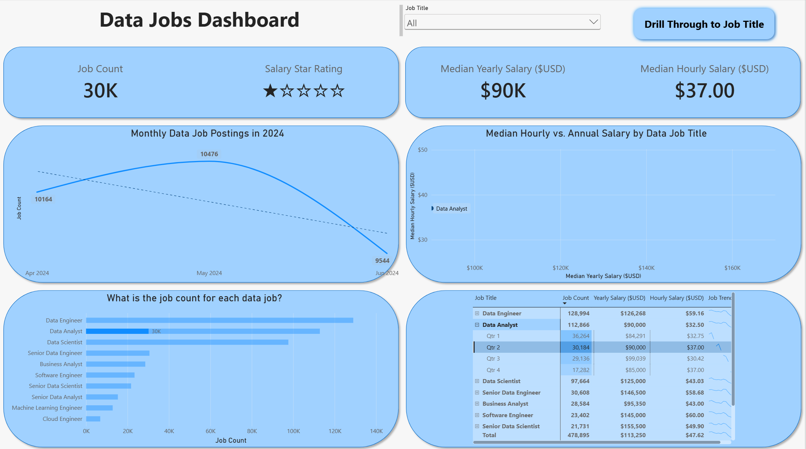
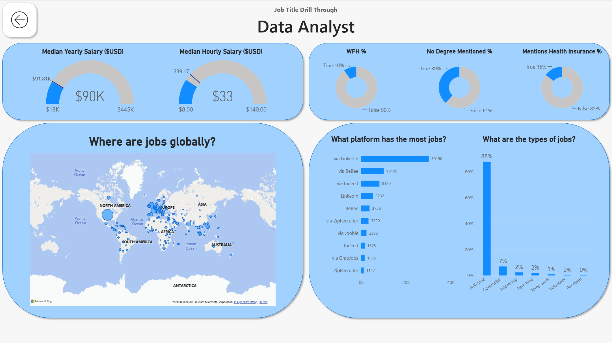

# Data Jobs Dashboard w/ Power BI

## Introduction

This project was initially developed as part of Luke Barousse's Power BI for Data Analytics course. The original dashboard was subsequently extended with independent analyses, additional visualizations, and data transformations

This dashboard was created for **Job Seekers, Job Transitioners, and Job Swappers** to solve a common problem: information about the data job market is scattered and hard to grasp. Using a real-world dataset of 2024 data science job postings (including titles, salaries, and locations), this project provides a single, easy-to-use interface to explore market trends and compensation.

### Dashboard File
You can find the file for the dashboard here: [`Data_Jobs_Dashboard.pbix`](/Data_Jobs_Dashboard.pbix).  

## Skills Showcased

This project was a journey through key Power BI features. Here's a look at what we mastered:

-   **Data Transformation (ETL) with Power Query:** Cleaned, shaped, and prepared the raw data for analysis by handling blanks, changing data types, and creating new columns.
-   **Implicit Measures:** Formulated measures to derive key insights and KPIs like `Median Yearly Salary` and `Job Count`.
-   **Core Charts:** Utilized **Column, Bar, Line, Scatter, Donut** and **Gauge Charts** to compare job counts and track trends over time.
-   **Geospatial Analysis:** Leveraged **Map Charts** to visualize the global distribution of jobs.
-   **KPI Indicators & Tables:** Used **Cards** to display key metrics and **Tables** to provide granular, sortable data.
-   **Dashboard Design:** Designed an intuitive and visually appealing layout, exploring both common and uncommon chart types to best tell the data story.
-   **Interactive Reporting:**
    -   **Slicers:** To dynamically filter the report by Job Title.
    -   **Buttons & Bookmarks:** To create a seamless navigation experience.
    -   **Drill-Through:** To navigate from a high-level summary to a contextual, detailed view.
---

## Dashboard Overview

*This report is split into two distinct pages to provide both a high-level summary and a detailed analysis.*

### Page 1: High-Level Market View

  

This is your mission control for the data job market. It showcases key KPIs like total job count, median salaries, and top job titles to give you a quick understanding of what's happening in the job market at a glance. All visuals are interactive to allow users to quickly filter by job title or date/quarter and then drill through to view specific details about the selected job title.

  

#### Notes:
-   The Salary Star Rating is based on the median yearly salary. Five Stars being jobs with a median salary of $150k or more. One star represent jobs with a median salary of $75k. Anything below $75 will have a zero rating.

### Page 2: Job Title Drill Through

  

This is the deep-dive page. From the main dashboard, you can drill through to this view to get specific details for a single job title, including salary ranges, work-from-home stats, top hiring platforms, and a global map of job locations. Users can click the back arrow to go back to the main dashboard and select a different job title.

#### Dataset Limitations:
-   No degree mentioned does not necessarily mean a degree is not required.
-   A posting that doesn't mention health insurance doesn't necessarily mean the employer doesn't provide it.
-   A posting not marked work-from-home shouldn't automatically be classified as strictly on-site.

---

## Key Findings

-   There were about 479K data jobs posted in 2024 with the median yearly salary being around $113k.
-   Data Engineer was the most frequently posted job with almost 27% of total job postings. Followed by Data Analyst (23.6%) and Data Engineer (20.5%).
-   About 10% of Data Analyst job postings are identified as WFH.

---

## Conclusion

This dashboard showcases how Power BI can transform raw job posting data into a powerful tool for career analysis. It allows users to slice, filter, and drill through data to make informed decisions about their career paths.

