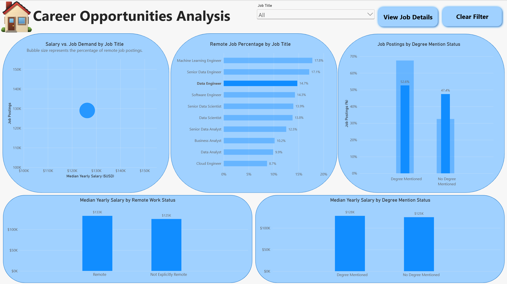

# Data Jobs Dashboard | Power BI

## Introduction

This interactive Power BI dashboard was initially developed as part of [Luke Barousse's Power BI for Data Analytics course](https://www.lukebarousse.com/powerbi). The project was subsequently expanded with original analyses, additional visualizations, custom DAX measures, and data transformations to explore relationships between job demand, compensation, remote-work opportunities, and degree mentions.

The report consists of three interactive pages, allowing users to explore overall market trends, compare career opportunities, and drill through to detailed information about specific job titles.

The dataset used in this project was provided through Luke Barousse's course and is available in the [course's GitHub repository](https://github.com/lukebarousse/PowerBI_Data_Analytics_Course/tree/main/Data).

### Dashboard File
You can find the file for the dashboard here: [`Data_Jobs_Dashboard.pbix`](/Data_Jobs_Dashboard.pbix).  

## Skills Showcased

This project demonstrates proficiency in the following Power BI tools and techniques:

- **Data Transformation (ETL) with Power Query:** Cleaned and prepared raw data by handling missing values, adjusting data types, and creating new columns. Additionally, standardized inconsistent job platform names and created descriptive categories for remote-work and degree-mention classifications.
- **Data Aggregation:** Used Power BI's built-in aggregation functions to calculate key metrics such as `Median Yearly Salary` and `Job Count`.
- **DAX Measures:** Created custom measures to calculate remote-job percentages and developed a salary star rating using DAX.
- **Data Visualization:** Utilized Column, Bar, Line, Scatter, Donut, and Gauge Charts to analyze job demand, salary trends, remote-work opportunities, and employment characteristics.
- **Geospatial Analysis:** Leveraged Map Charts to visualize the global distribution of job postings.
- **KPI Indicators & Tables:** Used Cards to highlight key metrics and Tables to provide detailed, sortable data.
- **Dashboard Design:** Designed a consistent, intuitive three-page report with complementary visualizations to communicate job-market insights.
- **Interactive Reporting:**
  - **Slicers:** Enabled dynamic filtering by job title across the analytical dashboards.
  - **Buttons & Bookmarks:** Implemented page navigation and filter-reset functionality to improve the user experience.
  - **Drillthrough:** Enabled navigation from high-level visualizations to detailed information about selected job titles.
---

## Dashboard Overview

*This report is split into three distinct pages to provide a high-level summary and a detailed analysis.*

### Page 1: High-Level Market View

  

Page 1 provides a high-level overview of the data job market, highlighting key metrics such as total job postings, median salaries, and the most in-demand roles. Interactive visuals allow users to filter results by job title and reporting period, with drill-through functionality providing access to more detailed information about individual roles by selecting a job title from one of the visuals and clicking the 'View Job Details' button.

  

**Interactive Filtering Example:** Selecting Data Analyst and Q2 2024 updates the dashboard to display approximately 30K matching job postings, along with their corresponding salary metrics and trends.

#### Notes:
The Salary Star Rating evaluates job titles based on their median annual salaries. The rating is calculated using a normalized salary scale ranging from $75,000 to $150,000, with the result rounded to the nearest whole star. Consequently, salaries below $82,500 receive zero stars, while salaries of $142,500 or higher receive five stars. Intermediate ratings are assigned in $15,000 salary increments.

| Star Rating | Median Annual Salary |
|:---:|---|
| ☆☆☆☆☆ (0 Stars) | Below $82,500 |
| ★☆☆☆☆ (1 Star) | $82,500 – $97,499.99 |
| ★★☆☆☆ (2 Stars) | $97,500 – $112,499.99 |
| ★★★☆☆ (3 Stars) | $112,500 – $127,499.99 |
| ★★★★☆ (4 Stars) | $127,500 – $142,499.99 |
| ★★★★★ (5 Stars) | $142,500 and above |

### Page 2: Career Opportunities Analysis

Page 2 provides details about job postings based on metrics such as remote work and the mention of a degree. This dashboard compares the salaries and demand for different job titles as well as their salaries based on the work status and the mention of a degree. Users can click the home icon to go back to the main dashboard or select a job title from one of the visuals and go to the deep-dive page for more details.

**Interactive Filtering Example:** Selecting Data Engineer updates the dashboard to display that approximately 14.7% of Data Engineer job postings offer remote work and 52.6% mention a required degree. The updated dashboard also displays the corresponding salary metrics by remote work status and the mention of a degree.

### Page 3: Job Title Drill-Through

  

This is the deep-dive page. From the main dashboard, you can drill through to this view to get specific details for a single job title, including salary ranges, work-from-home stats, top hiring platforms, and a global map of job locations. Users can click the home icon to go back to the main dashboard and select a different job title or view the career analysis dashboard.

## Original Analyses & Enhancements

To expand upon the original course project, I developed a third dashboard page titled **Career Opportunities Analysis**. This page introduces three independent investigations aimed at helping job seekers better understand the relationships between salary, hiring demand, remote-work opportunities, and educational requirements.

### 1. Salary, Job Demand, and Remote Opportunities
**Question:** Which data-related jobs offer the best combination of salary, demand, and remote-work opportunities?

- Created a bubble chart comparing median annual salaries, job posting counts, and remote-work percentages across job titles.
- Developed a separate bar chart ranking job titles by the percentage of postings offering remote work.
- **Purpose:** Identify career opportunities that balance competitive salaries, strong hiring demand, and remote-work flexibility.

### 2. Remote Work and Salary
**Question:** How do median salaries differ between remote and non-remote-tagged job postings?

- Created a column chart comparing median annual salaries between postings explicitly offering remote work and those not identified as remote.
- **Purpose:** Investigate whether remote-work availability is associated with differences in compensation.

### 3. Degree Mentions and Salary
**Question:** How do degree-mention classifications relate to job availability and compensation?

- Created a column chart comparing the percentage of job postings across degree-mention categories.
- Developed an additional visualization comparing median annual salaries between these categories.
- **Purpose:** Explore how degree-related posting classifications are associated with hiring demand and salary differences.

### Additional Technical Enhancements

Beyond the original analyses, I implemented several improvements to the guided project:

- **Power Query:** Standardized inconsistent job platform names and created descriptive categorical columns for remote-work and degree-mention classifications.
- **DAX Measures:** Developed custom calculations for remote-work percentages to support comparisons across job titles.
- **Interactive Reporting:** Added job-title filtering, navigation buttons, drillthrough functionality, and bookmark-based filter resets to improve dashboard usability.

These additions extend the original guided project by demonstrating independent analytical thinking, data preparation, and interactive reporting skills.

## Dashboard Navigation

- **Market Overview:** Users can filter job-market data using interactive charts and slicers, or select a job title from a chart to access the detailed drill-through page.
- **Career Opportunities Analysis:** Users can explore the original investigations, filter results by job title, and drill-through to additional job-specific information.
- **Job Title Drill-Through:** This detail page is accessible through the "View Job Details" buttons and provides additional information about the selected role.

Navigation buttons allow users to move between the two analytical pages, while filter-reset controls restore the relevant dashboard views.

## Key Findings

-   **Overall Job Market:** The dataset contains approximately 479,000 data-related job postings from 2024, with an overall median reported annual salary of approximately $113,000.
-   **Most In-Demand Roles:** Data Engineer accounted for the largest share of postings (26.9%), followed by Data Analyst (23.6%) and Data Scientist (20.4%).
-   **Remote Work Availability:** Approximately 10% of Data Analyst postings were explicitly identified as offering work-from-home opportunities.
-   **Remote Salary Compensation:** Postings tagged as remote have a median yearly salary of $130,000 compared to $113,000 for other postings
-   **Degree-mention Salary Compensation:** Postings that mention a degree have a median yearly salary of $114,000 compared to $110,000 for those that do not.
-   **Degree-mention Distribution:** Approximately 67.5% of job postings mention a degree.
-   **Remote Opportunities by Job Title:** Machine Learning Engineer had one of the highest observed remote-posting percentages, approximately 17.8%.

---

## Dataset Limitations
-   **Degree Requirements:** A job posting that does not explicitly mention a degree may still require one.
-   **Health Insurance:** A posting that does not mention health insurance does not necessarily indicate that the employer offers no coverage.
-   **Remote Work:** Job postings not explicitly identified as remote should not automatically be classified as on-site positions.
-   **Salary Data Coverage:** Salary statistics are calculated using postings with available salary information and may not represent the entire job market.
-   **Salary Comparisons:** Differences in median salaries between job categories do not necessarily mean that one characteristic causes higher pay. Other factors, such as job title, experience, and location, may contribute to these differences.
---

## Conclusion

This project demonstrates how Power BI can be used to transform job posting data into an interactive analytical report. By combining market-level trends with detailed job-title analysis, the dashboard helps users compare career opportunities while showcasing practical skills in data preparation, visualization, and interactive reporting. By extending the original guided project with independently developed analyses, the report demonstrates both technical Power BI proficiency and the ability to formulate and investigate meaningful business questions.

