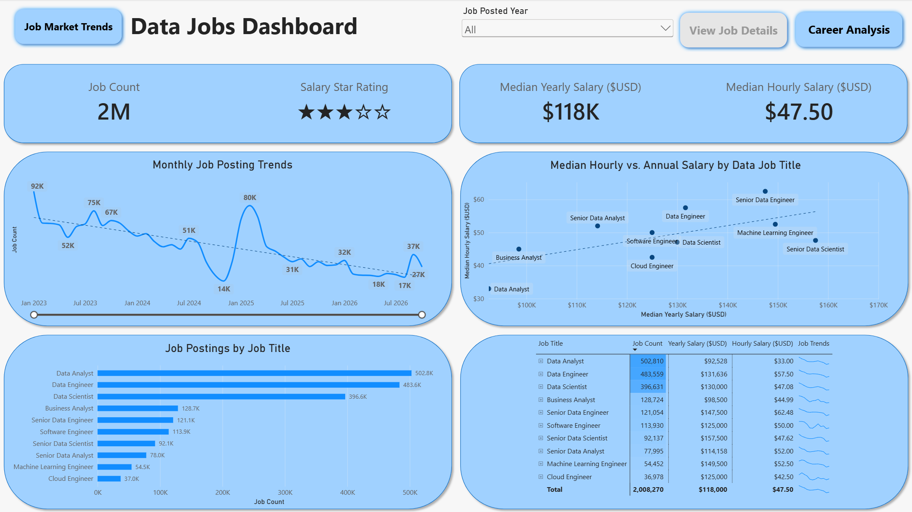
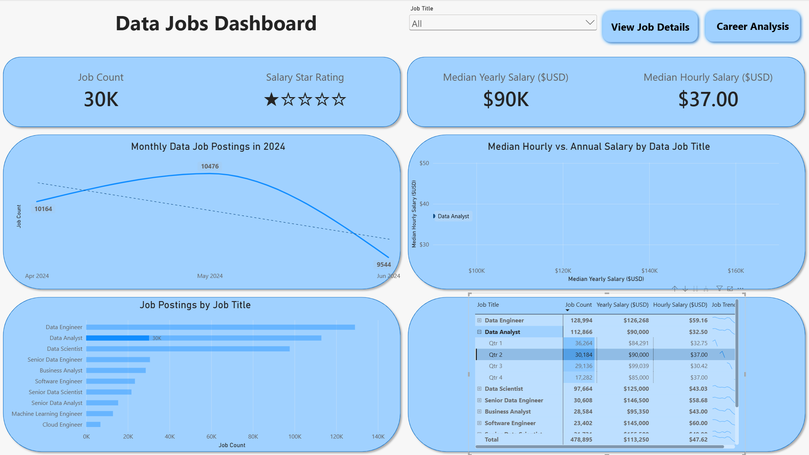
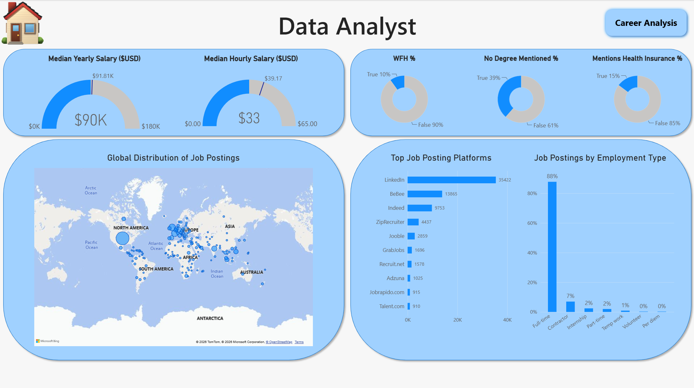

# Data Jobs Dashboard | Power BI

## Introduction

This interactive Power BI dashboard was initially developed as part of [Luke Barousse's Power BI for Data Analytics course](https://www.lukebarousse.com/powerbi). The project was subsequently expanded with original analyses, additional visualizations, custom DAX measures, and data transformations to explore relationships between job demand, compensation, remote-work opportunities, and degree mentions.

The report consists of four interactive pages for exploring the data job market, comparing career opportunities, tracking year-over-year trends, and drilling through to individual job titles.

The current report uses a refreshed extract of Luke Barousse's job postings data covering January 1, 2023 through October 31, 2026. The original 2024 course dataset is available in the [course's GitHub repository](https://github.com/lukebarousse/PowerBI_Data_Analytics_Course/tree/main/Data).

### Dashboard File
You can find the file for the dashboard here: [`Data_Jobs_Dashboard.pbix`](/Data_Jobs_Dashboard.pbix).  

## Skills Showcased

This project demonstrates proficiency in the following Power BI tools and techniques:

- **Data Transformation (ETL) with Power Query:** Cleaned and prepared raw data by handling missing values, adjusting data types, and creating new columns. Additionally, standardized inconsistent job platform names and created descriptive categories for remote-work and degree-mention classifications.
- **Data Aggregation:** Used Power BI's built-in aggregation functions to calculate key metrics such as `Median Yearly Salary` and `Job Count`.
- **DAX Measures:** Created custom measures to calculate remote-job percentages and developed a salary star rating using DAX.
- **Data Visualization:** Utilized Column, Bar, Line, Scatter, Donut, and Gauge Charts to analyze job demand, salary trends, remote-work opportunities, and employment characteristics.
- **Geospatial Analysis:** Leveraged Map Charts to visualize the global distribution of job postings.
- **KPI Indicators & Tables:** Used Cards to highlight key metrics and Tables to provide detailed, sortable data.
- **Dashboard Design:** Designed a four-page report that connects the market overview, career comparisons, year-over-year trends, and role-level detail.
- **Interactive Reporting:**
  - **Slicers:** Synchronized the posting-year filter across the market overview, career analysis, and drillthrough pages. Added a separate role slicer on the Trends page.
  - **Navigation Buttons:** Added direct links between report pages and to the role drillthrough.
  - **Drillthrough:** Enabled navigation from high-level visualizations to detailed information about selected job titles.
---

## Dashboard Overview

*The four pages cover the market overview, career opportunities, year-over-year trends, and job-specific details.*

### Page 1: High-Level Market View

  

Page 1 provides a high-level overview of the data job market, highlighting key metrics such as total job postings, median salaries, and the most in-demand roles.

Use **Job Posted Year** to filter the page, or select a role from a chart and click **View Job Details** to open the drillthrough page. The **Monthly Job Posting Trends** chart has a horizontal zoom slider, and the **Job Postings by Job Title** chart displays counts in thousands.

  

**Interactive Filtering Example:** Selecting 2024 in **Job Posted Year** shows approximately 481,000 postings and a median reported annual salary of $115,000.

#### Notes:
The Salary Star Rating evaluates job titles based on their median annual salaries. The rating is calculated using a normalized salary scale ranging from $75,000 to $150,000, with the result rounded to the nearest whole star. Consequently, salaries below $82,500 receive zero stars, while salaries of $142,500 or higher receive five stars. Intermediate ratings are assigned in $15,000 salary increments.

| Star Rating | Median Annual Salary |
|:---:|---|
| ☆☆☆☆☆ (0 Stars) | Below $82,500 |
| ★☆☆☆☆ (1 Star) | $82,500 – $97,499.99 |
| ★★☆☆☆ (2 Stars) | $97,500 – $112,499.99 |
| ★★★☆☆ (3 Stars) | $112,500 – $127,499.99 |
| ★★★★☆ (4 Stars) | $127,500 – $142,499.99 |
| ★★★★★ (5 Stars) | $142,500 and above |

### Page 2: Career Opportunities Analysis

Page 2 presents the original **Career Opportunities Analysis**, comparing job demand, median annual salaries, remote-work availability, and degree-mention classifications across different job titles. The dashboard combines these metrics to help users evaluate career opportunities and investigate differences in compensation.

Use **Job Posted Year** to filter the page, or select a job title in a chart to explore that role. Click **View Job Details** to open the drillthrough page or **Job Market Trends** to compare years.

**Interactive Filtering Example:** With all years selected, choosing Data Engineer in the **Salary vs. Job Demand by Job Title** chart shows that approximately 10.4% of Data Engineer postings are tagged as remote and 53.1% mention a degree. The salary comparison charts update for the selected role.

### Page 3: Job Market Trends (2023–2026)

Two line charts compare job posting counts and median reported annual salaries by role and year. Both use the January 1–October 31 window for every year so the comparison uses the same months as the partial 2026 data.

The role slicer defaults to Business Analyst, Data Analyst, Data Engineer, Data Scientist, and Software Engineer. The page is independent of the shared **Job Posted Year** slicer. Select a role's data point and click **View Job Details** to drill through.

### Page 4: Job Title Drill-Through

  

Page 4 provides a detailed analysis of individual job titles selected from any of the three analytical pages. It displays median salaries, remote-work availability, degree mentions, health insurance information, leading job posting platforms, employment types, and geographic distribution.

Users can return to the main dashboard using the Home button or navigate directly to **Career Opportunities Analysis** or **Job Market Trends**.

## Original Analyses & Enhancements

To expand upon the original course project, I developed an additional dashboard page titled **Career Opportunities Analysis**. This page introduces three independent investigations examining the relationships between salary, hiring demand, remote-work opportunities, and degree mentions to help job seekers make more informed career decisions.

### 1. Salary, Job Demand, and Remote Opportunities
**Question:** Which data-related jobs offer the best combination of compensation, hiring demand, and remote-work opportunities?

- Created a bubble chart comparing median annual salaries, job posting counts, and remote-work percentages across job titles.
- Developed a separate bar chart ranking job titles by the percentage of postings offering remote work.

**Purpose:** Identify career opportunities that balance competitive salaries, strong hiring demand, and remote-work flexibility.

### 2. Remote Work and Salary
**Question:** How do median salaries differ between remote and non-remote-tagged job postings?

- Created a column chart comparing median annual salaries between postings explicitly offering remote work and those not identified as remote.

**Purpose:** Investigate whether remote-work availability is associated with differences in compensation.

### 3. Degree Mentions and Salary
**Question:** How do degree-mention classifications relate to job availability and compensation?

- Created a column chart comparing the percentage of job postings across degree-mention categories.
- Developed an additional visualization comparing median annual salaries between these categories.

**Purpose:** Explore how degree-related posting classifications are associated with hiring demand and salary differences.

### 4. Year-over-Year Job Demand and Salary
**Question:** How did posting volume and median reported annual salaries change by role from 2023 to 2026?

- Built two line charts using the posting date hierarchy for the year axis and job title for the series.
- Applied a January–October filter to both charts so each year is compared over the same months.

**Purpose:** Compare changes in posting activity and reported pay for individual roles over time.

### Additional Technical Enhancements

Beyond the original analyses, I standardized inconsistent job platform names, created descriptive categorical columns in Power Query, developed custom DAX measures, and added the synchronized year slicers and Trends navigation buttons. The slicers use the posting date hierarchy.

These additions extend the original guided project by demonstrating independent analytical thinking, data preparation, and interactive reporting skills.

## Dashboard Navigation

-   **Market Overview:** Users can filter job-market data using interactive charts and slicers, or select a job title from a chart to access the detailed drill-through page.
-   **Career Opportunities Analysis:** Users can explore the original investigations, select roles in charts, and drill through to job-specific information.
-   **Job Market Trends:** Open this page directly from the market overview, career analysis, or drillthrough. Use the role slicer to choose which series to compare.
-   **Shared Year Filtering:** The **Job Posted Year** slicers on Pages 1 and 2 are synchronized with each other and with a hidden slicer on Page 4. The Trends page displays all four years.
-   **Drillthrough Navigation:** Select a role in a chart on Pages 1–3 and click **View Job Details**. The drillthrough page is hidden from the report tabs and has direct links to the three analytical pages.

## Key Findings

-   **Overall Job Market:** The dataset contains 2,008,270 postings from January 2023 through October 2026. The overall median reported annual salary was $118,000.
-   **Most In-Demand Roles:** Data Analyst accounted for the largest share of postings (25.0%), followed by Data Engineer (24.1%) and Data Scientist (19.7%).
-   **Remote Work Availability:** Approximately 7.2% of Data Analyst postings were tagged as remote.
-   **Salary vs. Hiring Demand:** Data Engineer had 483,559 postings and a median reported annual salary of $131,636. Data Analyst had 502,810 postings and a median reported annual salary of $92,528.
-   **Remote Work and Salary:** Remote-tagged postings had a median reported annual salary of $129,500. Postings without an explicit remote tag had a median of $117,250, a difference of $12,250.
-   **Degree Mentions and Salary:** Postings that mention a degree had a median reported annual salary of $120,000. Postings with no degree mentioned had a median of $110,000, a difference of $10,000.
-   **Degree Mention Distribution:** Approximately 66.3% of postings mention a degree.
-   **Remote Opportunities by Job Title:** Senior Data Engineer had the highest share of remote-tagged postings in the dataset, at 13.2%.
-   **January–October Trends:** Data Engineer posting counts declined each year in the dataset, from 158,001 in 2023 to 53,140 in 2026. For Data Scientist postings with reported annual pay, the median rose from $125,925 in 2025 to $141,103 in 2026.

---

## Dataset Limitations
-   **Degree Requirements:** A job posting that does not explicitly mention a degree may still require one.
-   **Health Insurance:** A posting that does not mention health insurance does not necessarily indicate that the employer offers no coverage.
-   **Remote Work:** Job postings not explicitly identified as remote should not automatically be classified as on-site positions.
-   **Time Coverage:** The 2026 data ends on October 31. Both Trends charts use January through October for each year. Posting counts reflect the dataset, and differences in coverage can affect comparisons.
-   **Salary Data Coverage:** Salary statistics use the 103,533 postings with reported annual pay, approximately 5.2% of the dataset. Salary reporting can vary by year and role.
-   **Salary Comparisons:** Differences in median salaries between job categories do not necessarily mean that one characteristic causes higher pay. Other factors, such as job title, experience, and location, may contribute to these differences.
---

## Conclusion

This project demonstrates how Power BI can transform raw job posting data into an interactive analytical report. By extending the original guided project with independent analyses, DAX measures, and additional data transformations, the dashboard showcases both technical proficiency and the ability to investigate meaningful analytical questions. The resulting report allows users to explore hiring trends, compare career opportunities, and examine job-specific information.

